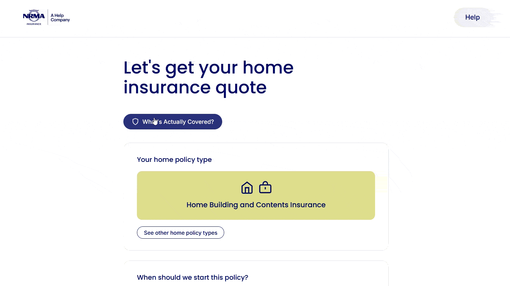

<h1 align="center">Hi, I'm Sean 👋</h1>

  <strong>UI/UX & Front-End Developer</strong> · Sydney, Australia 🇦🇺 
  I design and build interfaces that are clean, accessible and enjoyable to use, from Figma to production.

  
  
  

---

### 🙋 About me

- 💼 Currently working at **YouBeauty** as a UI/UX Developer where I redesigned the user experience for current features as well as designing and developing the user experience for new features.
- 🎓 Bachelors of Computer Science Majoring in Interaction Design at University of Technology Sydney (2026)
- 🎯 Looking for **UI/UX or front-end developer roles** in Sydney (web or mobile, hybrid/onsite/remote)
- 🌱 Currently learning React Native, Unity UI Toolkit, Crocheting
- ✨ Hobbies: bouldering, drawing, bubble tea, board games

### 🛠️ Tools & tech

<!-- Keep only what you'd be comfortable being asked about in an interview -->
**Design**

  

**Front end**

  
  
  
  

**Workflow**

  
  

### 🌟 Featured work

<!-- 2–4 best projects. A screenshot/GIF + live link does more than any paragraph. -->

| Project | What it is | Links |
|---|---|---|
| **What's Actually Covered?** | **2nd Place** in IAG Insurance Hackathon 2026. Ideation, user journey and initial design. | [Live](https://whatsactuallycovered.vercel.app/) · [Code](https://github.com/immanuel-lam/iaghackathon) |
| **Hallowvale Heist** | University game design final project, Pacman style game in a medieval fantasy setting featuring hand drawn assets. Play as the thief and run from the guards while collecting as many coins as possible around Hallowvale. Be sure to visit mum down at the your home district at the bottom right of the map. | [Code](https://github.com/ILoveSlowPoke/HallowvaleHeist) |

### 🎬 Demos

<strong>▶ What's Actually Covered?</strong> (hackathon prototype)

 

  

<strong>▶ Hallowvale Heist</strong> (gameplay)

 

  

Play as the thief: dodge the guards and grab as many coins as you can around Hallowvale.
Be sure to visit Mum in your home district at the bottom right of the map!

### 📫 Let's talk

I'm open to front-end and UI/UX opportunities in Sydney. The best way to reach me is
[LinkedIn](https://www.linkedin.com/in/sean-gocher24) or [email](mailto:sean.gocher61@gmail.com).
